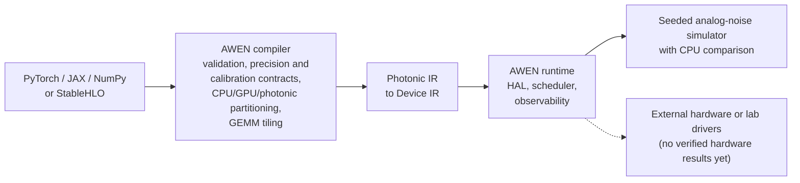

<div align="center">

# AWEN

**An open, experimental compiler and runtime for computing with light.**

[](LICENSE)
[](https://github.com/marcpoliquin5/awen/actions/workflows/observability-quality-gate.yml)

[Usage guide](docs/USAGE.md) · [Implementation status](docs/IMPLEMENTATION-STATUS.md) · [Evidence](docs/EVIDENCE.md) · [Changelog](CHANGELOG.md) · [Contributing](CONTRIBUTING.md)

</div>

## Why AWEN

Neural networks spend most of their time multiplying matrices. Programmable
photonic circuits can perform matrix multiplication with interfering light, but
they are analog, finite in size, sensitive to calibration and drift, and must
share work with CPUs and GPUs. AWEN is the software layer that takes a tensor
program from a standard framework and decides, with explicit precision, error,
and calibration contracts, what can run on a photonic matrix core, how to tile
it, and how to verify the result against a CPU reference.



> **Status:** AWEN 0.1.0 is an experimental, **simulator-only** release. Everything
> runs on conventional CPUs, and photonic results come from AWEN's noise-model
> simulator. No photonic hardware has been used, CUDA/GPU paths are untested, and
> physical accelerator performance is **not established**.

## What works today

| Component | What it does | Tests at 0.1.0 |
| --- | --- | --- |
| `awen-compiler` (Rust) | Typed tensor IR to a photonic GEMM plan: precision and error contracts, calibration-aware tiling, CPU/GPU/photonic partitioning, fault remapping, and a 25-kernel reference BLAS | 129 |
| `awen-runtime` (Rust) | `awenctl` CLI, hardware abstraction layer, scheduler, seeded analog-noise simulator with CPU comparison, benchmark evidence, and a C ABI | 305 |
| `awen-mlir` (C++, MLIR 20) | StableHLO `dot_general` (rank two and equal-batch rank three) lowered through three AWEN dialects to a versioned `AWENEXE` binary | lit/CTest |
| `awen-ecosystem`, `awen-native` (Python, PyO3) | `torch.compile` backend for matrix and linear regions, JAX StableHLO export/import, a NumPy runtime, and a binding to the Rust compiler and noise model | 48 + 23 |
| `awen-models` (Python) | AWEN-Mini, a 1.0M-parameter character-level language model trained on CPU that runs on CPU or the photonic simulator; noise-aware training experiments | 75 |
| `awen-physics`, `awen-qphotonic` (Python) | Reference physics solvers checked against analytic results, and quantum-photonic simulation | 51 + 61 |
| `awen-studio` (FastAPI, React) | Local web app over the compiler, simulator, AWEN-Mini and the Lab Agent | 14 |

Test counts are those recorded for the 0.1.0 release in [docs/EVIDENCE.md](docs/EVIDENCE.md)
(434 Rust and 345 Python tests in total, none failing, on an 8-vCPU Linux machine with no
GPU), together with the exact commands. The required CI gate re-runs the suites on every pull
request. Capability-by-capability status is in
[docs/IMPLEMENTATION-STATUS.md](docs/IMPLEMENTATION-STATUS.md) and
[docs/DIRECTIVE_TRACKER.md](docs/DIRECTIVE_TRACKER.md).

The implemented paths are deliberately narrow. Framework execution is a semantic reference
and dispatch boundary: it does not yet connect every captured framework region to generated
photonic device commands. Reference capability values and simulator cost estimates are not
measured product performance.

## Quickstart

Requires Rust 1.88 or newer (the minimum CI checks; `rust-toolchain.toml` pins 1.99.1, which rustup installs automatically) and Python 3.10 or newer.

```bash
git clone https://github.com/marcpoliquin5/awen.git
cd awen

# Compile a 256 x 256 GEMM for a 128 x 128 photonic matrix core
cargo run --manifest-path awen-runtime/Cargo.toml --bin awenctl -- \
  compile awen-compiler/examples/gemm_256.json \
  --capabilities awen-compiler/capabilities/pace_like_128.json \
  --health awen-compiler/capabilities/pace_like_128.health.json \
  --target photonic \
  --output awen_compilation.json
```

Or use AWEN as a `torch.compile` backend for matrix and linear regions:

```bash
python -m pip install -e "awen-ecosystem/python_awen[frameworks,test]"
```

```python
import torch
from awen_py import awen

model = torch.compile(model, backend=awen, dynamic=True)
```

The full build-and-verify procedure is in [Build and verify](#build-and-verify).

### Run the AWEN-Mini model

`awen-models` ships a small character-level language model (AWEN-Mini, 1.0M
parameters) that was trained on CPU, with its checkpoint bundled:

```bash
python -m pip install ./awen-native ./awen-models   # awen-native needs the Rust toolchain
python - <<'PY'
import awen
rt = awen.Runtime(device="auto")                # CPU/GPU, measured
print(rt.load_model("awen-mini").generate("ROMEO:", max_new_tokens=80))
sim = awen.Runtime(device="photonic-sim")       # every linear layer on the Rust noise model (simulated)
print(sim.load_model("awen-mini").generate("ROMEO:", max_new_tokens=80))
PY
```

At the default illustrative noise contract (1,000 photons per MAC, 8-bit
converters) the simulated output is visibly degraded. Validation loss
against simulated optical power is in `awen-models/results/photonic-sim-demo.json`.

### Open AWEN Studio (local web app)

`awen-studio` is a local browser UI over the same backends: projects, AWEN-Mini
generation on CPU or the photonic simulator, compiler placement and
diagnostics, the operator table, noise-contract editing, photonic-sim vs CPU
comparisons, Lab Agent experiment history and report export. It runs on
`127.0.0.1` only and is not hosted anywhere. See `awen-studio/README.md`.

```bash
python -m pip install ./awen-native ./awen-models ./awen-qphotonic ./awen-lab ./awen-studio
(cd awen-studio/frontend && npm ci && npm run build)
awen-studio            # http://127.0.0.1:8765
```

## Repository layout

The components in the table above, plus:

- `awen-spec`: schemas, specifications, and AWEN Enhancement Proposals (AEPs).
- `awen-systems`: modeled photonic memory and optical/electrical interconnect simulators.
- `awen-lab`: simulation-only Lab Agent with approval gates; hardware actions are refused.
- `research`: research ledger, research-to-code pipeline, and hypotheses with falsification criteria.
- `benchmarks`: benchmark suites and stored results.
- `docs`: usage guide, evidence, status, release process, and session history.

## Build and verify

For a pinned, hash-checked CPU install of the Python packages, see [docs/install.md](docs/install.md).

Install the current stable Rust toolchain with `rustfmt` and `clippy`, then run:

```bash
python -m pip install -e "awen-ecosystem/python_awen[frameworks,test]"
python scripts/validate_repository.py
python scripts/validate_json.py
python scripts/check_dependency_licenses.py

cargo fmt --manifest-path awen-compiler/Cargo.toml --all -- --check
cargo clippy --manifest-path awen-compiler/Cargo.toml --all-targets --all-features -- -D warnings
cargo test --manifest-path awen-compiler/Cargo.toml --all-features --no-fail-fast

cargo fmt --manifest-path awen-runtime/Cargo.toml --all -- --check
cargo clippy --manifest-path awen-runtime/Cargo.toml --all-targets --all-features -- -D warnings
cargo test --manifest-path awen-runtime/Cargo.toml --all-features --no-fail-fast

python -m pytest awen-ecosystem/python_awen/tests -q

cmake -S awen-mlir -B awen-mlir/build -G Ninja \
  -DMLIR_DIR=/usr/lib/llvm-20/lib/cmake/mlir \
  -DLLVM_DIR=/usr/lib/llvm-20/lib/cmake/llvm \
  -DCMAKE_C_COMPILER=clang-20 \
  -DCMAKE_CXX_COMPILER=clang++-20 \
  -DCMAKE_BUILD_TYPE=Release
cmake --build awen-mlir/build --target awen-opt awen-compile -j2
ctest --test-dir awen-mlir/build --output-on-failure
```

## Documentation

| Document | Contents |
| --- | --- |
| [docs/USAGE.md](docs/USAGE.md) | Compiler pipelines step by step, and walkthroughs for compiling through MLIR, the calibrated benchmark, artifact refresh, the full-system benchmark suite, and Photonic IR V5 migration |
| [docs/EVIDENCE.md](docs/EVIDENCE.md) | Commands, test counts and measured results for 0.1.0 |
| [docs/IMPLEMENTATION-STATUS.md](docs/IMPLEMENTATION-STATUS.md) | What is implemented, partial, removed or not offered |
| [docs/install.md](docs/install.md) | Pinned, hash-checked CPU install |
| [docs/RELEASING.md](docs/RELEASING.md) | Release criteria and artifacts |
| [STATUS.md](STATUS.md), [DECISIONS.md](DECISIONS.md), [EXPERIMENTS.md](EXPERIMENTS.md) | Current phase, recorded decisions, and the experiment log |

## Status and evidence

AWEN 0.1.0 is a simulator-only software release. Its binaries, wheels and AWEN-Mini checkpoint
are attached to the GitHub Release built by `.github/workflows/release.yml`, with checksums and
build-provenance attestations. It is not a hardware product.

The repository ships no measured physical-accelerator artifact and makes no hardware-performance
claim. Any future performance claim must be generated from verified, immutable end-to-end
artifacts that include host transfer, memory, scheduling, reconfiguration, lasers, DAC/ADC,
calibration, digital post-processing, and support power (AEP-0019,
`awen-spec/specs/hardware-benchmarking.md`).

Project decisions and reporting paths are defined by [GOVERNANCE.md](GOVERNANCE.md),
[CONTRIBUTING.md](CONTRIBUTING.md), [MAINTAINERS.md](MAINTAINERS.md), and [SECURITY.md](SECURITY.md).
