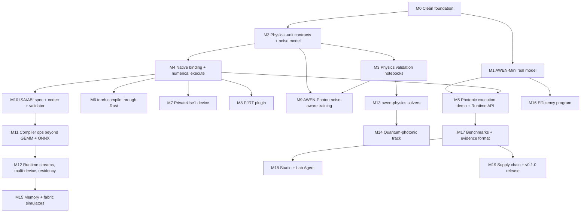

# AWEN roadmap

Simulation first. Every milestone has an acceptance test that runs in CI, and
the hardware it would need for full validation. No milestone claims hardware
results; anything physical carries a fidelity label (analytic, compact model,
numerical propagation, full-wave, digital twin, measured).

Status values follow `docs/DIRECTIVE_TRACKER.md`.

## Dependency graph

## Milestones

| # | Milestone | Depends on | Acceptance test (CI) | Hardware needed for full validation | Issue |
| --- | --- | --- | --- | --- | --- |
| M0 | Clean foundation: pinned toolchain, MSRV, weekly gate, deps, dead code removed | none | Required gate green on `main`; weekly schedule | none | #51–#54 |
| M1 | AWEN-Mini ~1M-param char LM trained for real; checkpoint, generate, int8, nonlinear ablation, HF adapter | M0 | `awen-models` pytest; bundled checkpoint loads and reproduces its recorded validation loss | none (CPU) | this directive |
| M2 | Physical-unit precision/noise contracts and noise model | M0 | Monte Carlo variance of each noise term within stated tolerance of analytic | measured device noise to set parameter values | #56, #57 |
| M3 | Validation notebooks: slab waveguide, Clements mesh, shot-noise ENOB | M2 | each notebook's tolerance asserted in pytest | none | #58 |
| M4 | PyO3 binding, numerical `awenctl execute` | M2 | simulated GEMM matches NumPy within contract tolerance | none | #59 |
| M5 | AWEN-Mini linear layer on the simulator; `Runtime(device='photonic-sim')` | M1, M4 | generation runs; per-layer error vs CPU oracle within contract | none | #59 |
| M6 | `torch.compile(backend=awen)` routes GEMMs through Rust | M4 | test asserts native calls and numeric match | none | #59 |
| M7 | PyTorch PrivateUse1 `awen` device (to/from, matmul/linear, add, relu) | M4 | op tests vs CPU | none | #60 |
| M8 | Minimal PJRT plugin for StableHLO dot/dot_general | M4 | JAX `jnp.dot` on AWEN matches CPU | none | #61 |
| M9 | AWEN-Photon: differentiable MZI meshes, noise-injection training, accuracy-vs-ENOB/energy curves | M2, M3 | toy run reproduces committed curve within seed variance | measured MZI mesh for transfer | #73 |
| M10 | Virtual Photonic ISA/ABI + codec + validator (classical and separate quantum domain) | M4 | round-trip property tests; negative validation tests | none | #55 |
| M11 | Ops beyond GEMM with 4-level labels; ONNX import | M10 | per-op oracle tests; ONNX fixtures | hardware-lowerable/measured levels | #62, #63, #65 |
| M12 | Runtime streams/events, multi-device, residency, leases, remap, fallback, profiling, plugin isolation | M11 | ordering, replay and isolation tests | multi-device hardware | #64 |
| M13 | awen-physics: TMM, mode solver, FDTD, BPM, rings, thermo/electro-optic, chi2 SHG, adjoint | M3 | convergence and analytic-comparison tests | fabricated devices | #68 |
| M14 | Quantum-photonic track (separate domain) | M13 | permanent vs brute force; HOM visibility | single-photon sources/detectors | #69 |
| M15 | Memory subsystem and fabric simulators | M12 | M/M/1 and alpha-beta analytic checks | none | #70, #71 |
| M16 | Efficiency program ablations and Pareto frontier | M1 | matched-budget, multi-seed runs | measured energy | #72 |
| M17 | Benchmarks with immutable evidence, CIs, multiple seeds | M5 | evidence schema validation; reproducible command | GPU/photonic rows | #74 |
| M18 | Studio local web app; Lab Agent (simulation only, approval gates) | M17 | API tests + e2e smoke; gate tests | none (hardware actions disabled) | #75, #76 |
| M19 | SBOM, checksums, reproducible builds, release with real artifacts | M0 | release dry run produces wheels/binaries + SBOM | none | #78 |

## Out of scope until hardware exists

Measured speed or energy claims, vendor drivers, and a hosted cloud service.
The cloud architecture is documented in `docs/CLOUD-ARCHITECTURE.md` and is
marked not available.
